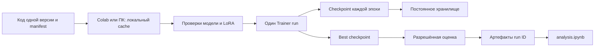

# Архитектура реализации

Редакция 25.11.2026. Архитектура согласованной серии: 20 200 изображений, пять эпох, 12 LR + 12 final runs. Реализация не начата. Протокол — [02-protocol.md](02-protocol.md), ресурсы — [04-team-and-plan.md](04-team-and-plan.md).

## Один пайплайн

Пользователь с ассистентом пишут весь код. Не делим исходники между участниками и не создаём отдельные реализации методов/площадок.

| Будущий файл | Ответственность |
| --- | --- |
| configs.py | конкретные модули, ranks/alpha, таблица и формулы параметров |
| data.py | manifest, dataset/transforms/collator |
| train.py | один run: сборка, проверки, Trainer, resume, оценка, артефакты |
| colab.ipynb | тонкая оболочка: setup/Drive/данные/проверки/запуск/sync |
| analysis.ipynb | сборка результатов, статистика, графики |
| test_params.py | модули, численность, freeze и gradients на малом batch |
| requirements.txt | точные версии после технической проверки |
| runs.json | явный список run ID/config/seed/LR/stage |

Train принимает config, seed, LR, stage (technical/lr_search/final), manifest, output root и опциональный resume checkpoint. Стадии technical и lr_search запрещают test. Очередь содержит только LP, A-iso, M-iso и B-iso; конфигурации REF и серии по рангам не реализуем для текущего плана. На ПК тот же интерфейс, отличаются пути. Достаточно явного назначения заданий; scheduler/БД/автоматический захват задач не нужны.



## Окружение и выбор модулей

Закрепляем одну версию Transformers. 4.57.1 — кандидат с проверенной прежней структурой ViT, не проверенный полный стек. Не обновляем библиотеки произвольно в каждой сессии. Фиксируем Python, torch/torchvision, CUDA runtime/driver, Transformers/PEFT/Accelerate/Datasets и commit; пока Git не инициализирован — хеш исходников.

Из named_modules собираем **полные имена** нужных Linear во всех 12 блоках. Для Both ranks/alpha задаём по конкретным матрицам. Общий suffix dense непригоден: захватывает обе группы. При неожиданной структуре останавливаемся, не ищем похожие имена автоматически.

Проверки каждого run:

1. 12 блоков, формы шести матриц, 101 выход head.
2. LoRA-модули: Attention 48, MLP 24, Both 72, LP 0.
3. Для каждого: layer/group/rank/alpha/scaling и формы A/B.
4. Trainable whitelist: LoRA A/B и активная classifier; LP только head.
5. Сумма параметров по протоколу, отдельно LoRA/head; знаменатель доли явно указан.
6. Одинаковый хеш начальной head для одного seed; backbone соответствует revision.

Smoke test: forward, конечный loss, backward, optimizer step, изменение head/LoRA, неизменность frozen weights. При B=0 первый gradient A может быть нулевым: проверяем B сразу и A после следующих шагов. Одной суммы параметров недостаточно для проверки целевых модулей.

## Данные/диски

Один manifest всех машин: revisions, row ID/labels/order, алгоритм/seed стратификации, counts/hashes. Проверяем ровно 20 200 выбранных изображений: 18 180 train и 2 020 val; по 180/20 на каждый из 101 класса, без пересечений. Все 24 обучения используют этот manifest. Test имеет фиксированные ID/labels/order. Декодируем и преобразуем изображения при чтении, весь float-dataset в RAM не держим.

Данные/HF cache локально, в Colab под /content. Drive — постоянные результаты, при необходимости архив; изображения не читаем с Drive на каждом batch. Не дублируем полный cache через save_to_disk без необходимости. Текущие [Parquet Food-101](https://huggingface.co/datasets/ethz/food101/tree/main/data) занимают около 5,06 GB; окружение/cache/checkpoints требуют дополнительного диска. Ориентир запаса 15–20 GB — не измеренный минимум.

Load_dataset может скачать весь split до выбора 20 200 строк. Это setup-time. Streaming не используем: индексируемая выборка проще для stratification/shuffle/resume. Компактную подготовку поднабора добавляем только при реальной проблеме загрузки.

## Colab/ПК

Одна сессия — один run одновременно. До старта GPU/VRAM, RAM, диск, версии. Microbatch проверяем коротким запуском B-iso на поднаборе train из manifest, не добавляя полное предварительное обучение. AMP FP16/backend общий. Quantization, DeepSpeed, DDP и обучение одной модели на нескольких GPU в первую версию не входят.

На ПК те же manifests/configs и совместимый стек. VRAM всех карт проверяем nvidia-smi, особенно модификацию RTX 3060. Доступность ПК/ОС ещё уточняются. Участникам нужны готовые команды и окружение.

## Артефакты

```text
experiment/
  protocol/                  # manifest, labels, runs.json, выбранные LR
  runs/<run_id>/
    config.json              # разрешённые настройки/hash
    environment.json         # GPU, версии, code/data/model revisions
    status.json              # pending/running/interrupted/completed/failed
    history.json             # train/val, LR, global_step
    metrics.json             # итоговые метрики стадии
    predictions.npz          # final: ID, true/predicted labels
    norms.json               # LoRA из best checkpoint
    best/                    # adapter+head либо head LP
    resume/                  # последний подтверждённый checkpoint
    COMPLETE                 # после проверки обязательных файлов
  results.csv                # производная сводка final
  lr_trials.csv              # производная сводка поиска
```

Run ID содержит protocol/config/seed/LR/stage и hash настроек; связан с code/data hashes. Изменение протокола создаёт новый ID. Повторная попытка получает attempt ID, данные об обрыве сохраняются. Одному run ID назначен один исполнитель.

**Не дописываем общий CSV из пяти сессий.** Каждый run пишет свой каталог, analysis проверяет и собирает сводку. Final без predictions/best checkpoint незавершён.

## Восстановление

Каждую эпоху полный Trainer checkpoint: adapter/head, optimizer, scheduler, AMP scaler при наличии, RNG/trainer state. Один экспорт адаптера не восстанавливает оптимизацию. Best и последний resume checkpoint храним отдельно: это могут быть разные эпохи. Для LP явно сохраняется head.

Сначала локальное сохранение, затем новая временная папка постоянного хранилища, проверка комплектности/hashes, marker последним. На Drive не предполагаем транзакционность переименования. Предыдущую исправную копию удаляем после подтверждения новой. Resume копирует подтверждённый checkpoint локально и продолжает **до суммарных пяти эпох**, не ещё на пять.

Drive sync после каждой эпохи во время обучения, не только последней ячейкой notebook. На ПК допустим постоянный локальный output и перенос. При обрыве теряется работа после последней подтверждённой эпохи.

Resume проверяем техническим запуском. Изначально num_workers=0 для простого контроля RNG; совпадение аугментаций после восстановления проверяем. Смену GPU фиксируем; такой run исключаем из сравнения стоимости. При смене вычислительного режима/окружения final предпочтительно перезапустить целиком.

## Техническая проверка до LR search

Цель — исправность и замер ресурсов, не поиск оптимального числа эпох и не предварительная исследовательская серия A/M/B.

- Несколько optimizer steps LP и A/M/B-iso: формы, gradients, freeze и обновления head/LoRA.
- Короткий B-iso на фиксированном поднаборе train из manifest: RAM/VRAM, скорость, accumulation/global_step. Поднабор не заменяет основной train и не используется для выбора LR.
- В техническом запуске с короткими условными эпохами проверяем сохранение, загрузку best и прерывание/resume optimizer/scheduler/RNG; проверяем совпадение predictions после reload.
- Скорость inference измеряем на val-2020; test до фиксации настроек не загружаем. Замер на поднаборе экстраполируем с оговоркой; фактические времена берём из завершённых runs.
- Фиксируем versions/microbatch/backend/manifest, пересчитываем бюджет. Число эпох основной серии остаётся пять.

LR search и final: ровно пять эпох, val-2020 и сохранение после каждой; best из пяти, tie-break по ранней эпохе. Обязательные scalar fields: train_loss, val_loss, val_acc, best_epoch, global_step, train/val/test timings. Final test и norms считаются на выбранном checkpoint; для поиска test/predictions отсутствуют.

History JSON/TensorBoard достаточно, W&B и публикация Hub не обязательны. Публичные модель/данные не требуют публикации результатов или обязательного login.

Основания: [Trainer](https://huggingface.co/docs/transformers/main_classes/trainer), [PEFT checkpoint](https://huggingface.co/docs/peft/main/developer_guides/checkpoint), [LoRA](https://huggingface.co/docs/peft/main/package_reference/lora). Практическая совместимость/resume проверяются техническим запуском.

## Технический аудит: предложения к обсуждению

Статус этого раздела: рекомендации, не реализованные и не прошедшие runtime-проверку. Данные, пять эпох, ранги и согласованный LR search сохраняются. Ниже уточняем технический контракт перед кодом; текущие общие формулировки выше не заменяют этих проверок.

### 1. Версии, код и переносимость

**Пробел:** есть кандидат Transformers, но нет проверенного полного стека и зафиксированной версии кода на всех площадках. Одного requirements.txt мало: Python/torch/torchvision/CUDA тоже должны быть совместимы.

**Решение:** сначала минимальная проверка на Colab и самой маленькой реально участвующей локальной GPU; затем точные версии Python и библиотек, совместимые CUDA builds, model/dataset commit revisions. Код распространяется immutable commit или архивом с SHA-256; до появления Git допустим архив. Не тянуть изменяемый main при каждом подключении.

**Альтернативы:** текущие пакеты каждой машины — быстрее начать, труднее объяснить расхождения; Docker — более изолированное окружение, но лишняя поддержка для Colab/разных ОС. **Выбор:** проверенный стек и одна версия исходников, без контейнерной инфраструктуры. Драйверы не обязаны совпадать, но совместимость проверяется, версии сохраняются.

### 2. Контракт модели, PEFT и head

**Пробел:** заморозка и формула есть, но не полностью определена сборка модели и проверка активной head после PEFT.

**Решение:** ViTForImageClassification с num_labels=101 и согласованными label mappings; новая head с явной инициализацией (truncated normal std=config.initializer_range, bias=0) в собственном RNG-контексте до PEFT. Head trainable через modules_to_save; проверить активную копию после wrapping, а не только исходный classifier. PEFT generic wrapper для vision, без текстовых task_type. Проверять все 48/24/72 адаптера, их формы/ranks/scaling, нулевое начальное обновление, единственную активную обучаемую head и trainable whitelist.

**Альтернативы:** ручная реализация LoRA или выбор по общему suffix dense — меньше контроля либо больше собственного кода. **Выбор:** штатный PEFT и полные имена Linear; сверка параметров и несколько optimizer steps. Frozen backbone нельзя целиком оборачивать в no_grad в LoRA-методах: вычислительный граф к адаптерам нужен. Кешировать CLS-признаки только для LP пока не предлагаем: при случайных train crops это меняет/усложняет процедуру baseline.

### 3. Данные, ID и transforms

**Пробел:** названия классов/индексы есть, но не задана полная проверка идентичности изображений и параметров преобразований.

**Решение:** один manifest по dataset revision + source split + row index, labels и hashes выбранных bytes/записей. Row index не трактовать как глобальный ID вне revision. Сохранить единую таблицу ID→label, проверить ровно 180/20 на класс и декодирование выбранных train/val до очереди. Transforms описать полностью: crop scale/ratio/interpolation/antialias, flip probability, RGB, dtype, mean/std; test/val детерминированны. Не пропускать испорченные файлы тихо, исправление manifest общее для всех.

**Альтернативы:** повторно генерировать выборку на каждой машине или хранить только числовой seed — риск различий порядка/версий. **Выбор:** готовый manifest с проверкой данных. Seed нужен для восстановления процедуры, manifest — для идентичности входов.

### 4. Где хранить данные и результаты

**Пробел:** обозначены /content и Drive, но не выбран рабочий порядок загрузки, права и объём постоянного хранилища.

**Решение:** HF cache и изображения на локальном диске runtime; train читает локально. Один ответственный готовит manifest; каждый исполнитель проверяет тот же dataset revision и manifest hash. Первая версия читает исходный Parquet cache. Компактный архив выбранных train/val добавляем только если реальные повторные скачивания/подготовка мешают сроку. Копирование архива с Drive — один раз на сессию, не чтение изображений с Drive в каждом batch.

Для результатов — один постоянный корневой каталог с отдельными папками исполнителей/runs и проверенными правами. Если общий Drive не удаётся надёжно подключить всем, личные каталоги с последующим сбором архивов — допустимая замена без изменения артефактов.

**Альтернативы:** полностью Drive-backed dataset — прост, но зависим от мелких I/O; object storage — удобнее автоматизировать, но требует новой инфраструктуры. **Выбор:** локальные данные + Drive для checkpoints/результатов. Свободный диск проверяем по фактическим cache/временным копиям/checkpoints; 15–20 GB остаётся ориентиром, не гарантией. Размер постоянного хранилища измеряем на одном полном комплекте, не рассчитываем только по весам адаптера.

### 5. Случайности и идентичность входов

**Пробел:** один global seed не обеспечивает одинаковые crops/shuffle после создания разных адаптеров или resume.

**Решение:** раздельные RNG для head, LoRA и sampler; аугментации задавать устойчивым seed от experiment seed/epoch/sample ID, например через SHA-256, а не встроенный Python hash. Transforms выполняются в локальном RNG-контексте, не меняющем RNG dropout. Начать с num_workers=0, проверить одинаковые ID/crop-параметры между методами и после resume. При изменении workers повторить проверку; не выдавать побитовость между GPU за гарантию.

**Альтернативы:** только global set_seed — проще, но обещание парных аугментаций не выполнено; заранее сохранить все преобразованные изображения — лишний объём и фиксирование представлений. **Выбор:** вычисляемые seeds на пример/эпоху, без огромного кеша тензоров.

### 6. Microbatch, accumulation и OOM

**Пробел:** контроль global_step не проверяет нормировку последней неполной группы. 18 180 = 35×512 + 260; при microbatch16 последний microbatch содержит четыре изображения.

**Решение:** общий microbatch16/accumulation32 либо 8/64 выбирается до LR search по реальной маленькой GPU. Сохраняем все примеры, проверяем усреднение loss по числу изображений accumulation-группы, а не по числу microbatches. Проверка на малой детерминированной задаче без dropout/AMP сравнивает gradients/optimizer update большого batch и эквивалентной accumulation, включая неполную группу. Ожидаем около 36 updates/эпоху и 180/run, дополнительно логируем attempted/applied/skipped AMP updates.

**Альтернативы:** drop_last теряет данные; паддинг дублирует примеры; собственный цикл даёт контроль, но добавляет AMP/resume-код. **Выбор:** Trainer выбранной версии с проверкой семантики, минимальная корректировка loss только при необходимости. Не утверждать, что конкретная версия ошибается, до проверки.

При OOM после старта серии не уменьшать batch для одного метода молча: перенос на совместимое устройство либо новый общий профиль с проверкой зависимых результатов. Gradient checkpointing — запасной общий режим до серии, с проверкой gradients при frozen embeddings.

### 7. Precision и численная диагностика

**Пробел:** FP16 записан, но нет полного профиля math modes и порога технического вмешательства при повторных overflow.

**Решение:** единый AMP FP16, FP32 master weights/optimizer, backend и matmul/TF32 settings фиксируются перед LR search. Проверять finite loss/logits/веса, сохранять grad norm, scaler и число применённых/пропущенных updates. Изолированный scaler skip не объявлять numerical_invalid. Численные разрушения и повторное отсутствие обновлений диагностировать; точный критерий длительной серии skips принять до запуска и записать в config. Не переключать один неудачный LR на BF16/FP32 ради спасения результата.

**Альтернативы:** BF16 при поддержке всех участвующих GPU или весь FP32; разные precision по устройствам проще, но смешивают вычислительные режимы. **Выбор:** исходный общий FP16; смена общего режима только до поиска либо с новой версией протокола. Сопоставимость важнее возможности незаметно переключать dtype.

### 8. Checkpoint и перенос между машинами

**Пробел:** сохранение adapter и Trainer state по отдельности не гарантирует согласованный комплект; ссылки на best могут содержать путь /content старой VM.

**Решение:** epoch bundle с resume state, best weights, best epoch/metric, config/data/code hashes и относительными путями. При переносе локально проверить файлы, восстановить ссылки Trainer на существующий best, затем resume до суммарных пяти эпох. Проверить остановку на границе эпохи против непрерывного запуска на одном оборудовании; перенос на другую GPU проверяет успешность и корректность состояния, не побитовое равенство.

LP resume в первой версии может штатно сохранять полный ViT, чтобы не писать особый Trainer loader. Финальный LP export — только head; в сравнении размеров используем именно export, не большой resume checkpoint.

**Альтернативы:** хранить только adapter — недостаточно для optimizer resume; писать универсальный head-only resume loader сразу — дополнительный код. **Выбор:** штатное восстановление, отдельно компактные best exports, явная проверка переноса.

### 9. Публикация checkpoint и отказы Drive

**Пробел:** marker готовности без списка/checksums не подтверждает целостность; ошибка sync может оставить GPU обучаться без постоянной копии.

**Решение:** локальный checkpoint → новая версия папки → список файлов/размеров/SHA-256 → проверка → READY последним. До этого предыдущая подтверждённая версия сохраняется. Оставляем последнюю и предыдущую подтверждённые версии плюс best, старые удаляем только после верификации. Ограниченные повторные sync-попытки; если подтвердить сохранение не удалось, останавливаем очередь, не продолжаем следующие эпохи с ложным обещанием защиты. Отдельно сообщаем, какая эпоха действительно сохранена постоянно.

**Альтернативы:** писать checkpoint прямо на Drive — меньше шагов, выше риск частичного комплекта; копировать только в конце run — теряем весь run при отключении. **Выбор:** epoch sync, небольшой набор версий, fail-visible поведение. Drive не считаем транзакционной файловой системой.

### 10. Обучение и оценка как отдельные действия

**Пробел:** один режим final не описывает повторение test после сбоя без переобучения; до READY final может выглядеть просто failed.

**Решение:** остаётся один train.py, но действия train/resume/evaluate/export различаются; final проходит состояния training → trained → evaluating → completed. Evaluate загружает best, проверяет config/manifest и дописывает только отсутствующие артефакты. Повторная корректная оценка не новый seed и не новый поиск; существующий verified результат не затираем молча. Test разрешён только после фиксации LR всех четырёх методов и final queue (файл freeze с hashes). Публичные test bytes в скачанном cache сами по себе не утечка; доступ скрипта к test loader/метрикам до freeze запрещён.

**Альтернативы:** обучение и test неразделимы — при сбое лишние вычисления; отдельный большой eval-проект — дублирование сборки. **Выбор:** отдельные действия того же маленького пайплайна.

### 11. Run ID, назначения и попытки

**Пробел:** hash кода одновременно в идентичности run и требование resume после исправлений нуждаются в правилах; нет защиты от двойного назначения или разных значений LR в строковом виде.

**Решение:** canonical config сериализуется устойчиво, 1e-3 и 0.001 имеют одну числовую запись; run ID не зависит от путей/имени исполнителя/GPU. Существенные изменения кода/протокола создают новую конфигурацию; code hash и hardware сохраняются для каждой попытки. Совместимость resume после исправления явно разрешается ответственным, не определяется автоматически. Реестр ведёт один координатор; attempts отдельные, одна активная попытка на run, результаты никогда не перезаписываются двумя сессиями.

**Альтернативы:** распределённая БД/lock-сервис — надёжнее при большой команде, но избыточны для 24 конфигураций; один общий изменяемый CSV несколькими workers — гонки. **Выбор:** ручное назначение координатором и независимые папки.

### 12. Распределение устройств и измерение стоимости

**Пробел:** пожелание одной GPU на seed не предотвращает систематической привязки метода к конкретной карте; длительность сессии может не вместить весь блок.

**Решение:** final назначать четвёрками LP/A/M/B одного seed, цель — одна и та же карта/профиль. В LR search распределять по доступным устройствам блоки разных методов с одинаковым LR, затем ротировать, если одна GPU для всех 12 проб недоступна; не отдавать все LP одной карте, все MLP другой. Это снижает смешение, не устраняет все hardware-различия. Не требует одновременной работы Colab и ПК: правило применяется к реально доступным ресурсам.

**Альтернативы:** свободная выдача любой следующей задачи — лучше загрузка GPU, хуже парность; жёстко одна GPU для всей серии — проще сравнение, больше календарный риск. **Выбор:** парные блоки с переносом по границам runs; отклонения документируем. На одном устройстве желательно ротировать порядок методов по seed, чтобы один метод не был всегда первым.

Время разделять: setup, train, val, checkpoint/sync, test; измерять CUDA-синхронизированными интервалами. Для рейтинга времени учитывать фактический data-loader/CPU профиль: одинаковой модели GPU недостаточно. Если одинаковые условия обеспечить нельзя, показывать фактическую стоимость с hardware и без точного рейтинга методов. AMP/backend, batch/workers, CPU/RAM, storage/cache и warm/cold start записываем. Peak allocated/reserved измерять раздельно для train/val/test без вложенного сброса счётчиков Trainer; сравнивать одинаковые границы. Предпочтительно один run на процесс: освобождение памяти и независимые peaks проще проверить.

### 13. Схема метрик, outputs и тестовая оценка

**Пробел:** test timings объявлены обязательными для всех стадий, хотя test запрещён при поиске; нет полного schema/version/status contract.

**Решение:** schema version и условные поля: technical/lr_search без test metrics, test timings отсутствуют или null (не 0). Search status valid/numerical_invalid/interrupted/technical_failed и причина, final отдельно по полноте артефактов. Храним accuracy как correct_count/sample_count, fractions без округления до presentation. Определяем MB=10^6 bytes, GiB=2^30 bytes, dtype export общий.

Для test model.eval()+inference_mode/no_grad, фиксированные RGB/Resize/CenterCrop/Normalize, без shuffle/augmentations. Можно сразу сохранять argmax вместо всех logits: для McNemar/bootstrap этого достаточно. predictions с ID/true/predicted labels, manifest hash, shape/dtype и checksum. CPU/streaming сбор вместо удержания всех изображений/активаций в GPU RAM; batch eval проверен независимо от train.

**Альтернативы:** общий CSV с нулями и только accuracy — теряет статусы/точность; хранить все logits — полезно для calibration, но она не цель этой серии. **Выбор:** per-run JSON+NPZ, производные CSV, только необходимые предсказания. Evaluate/export из best не изменяют optimizer или веса. Norms FP32 считать по одной матрице под no_grad, чтобы не держать все dense ΔW в памяти.

### 14. Приёмка минимальной реализации

**Пробел:** длинный checklist не различает обязательные проверки перед массовыми runs и дополнительные улучшения.

**Решение:** до LR search нужны только (1) manifest/labels/transforms и revisions, (2) smoke LP/A/M/B и whitelist, (3) accumulation для полной/неполной группы, (4) train→save→resume и best reload, (5) sync failure/READY, (6) evaluate из best без train на разрешённой validation, (7) профили хотя бы Colab и самой маленькой используемой локальной GPU, (8) сборка мини-результатов с верными schema/status и без дублей. Не писать общую orchestration-платформу и фиктивные тесты каждой строки конфигов.

**Альтернативы:** сразу запускать LR search — ошибки дорого находить; сначала реализовать все возможные оптимизации — риск не уложиться в пять дней. **Выбор:** проверяем критические свойства и начинаем серию; ускорения workers/cache/precision только если измеренная проблема оправдывает изменение до поиска.

Основания для runtime-проверок: [Trainer](https://huggingface.co/docs/transformers/main_classes/trainer), [PEFT checkpoint format](https://huggingface.co/docs/peft/main/developer_guides/checkpoint), [PyTorch reproducibility](https://docs.pytorch.org/docs/2.15/notes/randomness.html), [Colab FAQ](https://research.google.com/colaboratory/faq.html?hl=en). Поддержку конкретного API всегда сверяем с выбранной закреплённой версией; ссылки main не являются lock-файлом.
